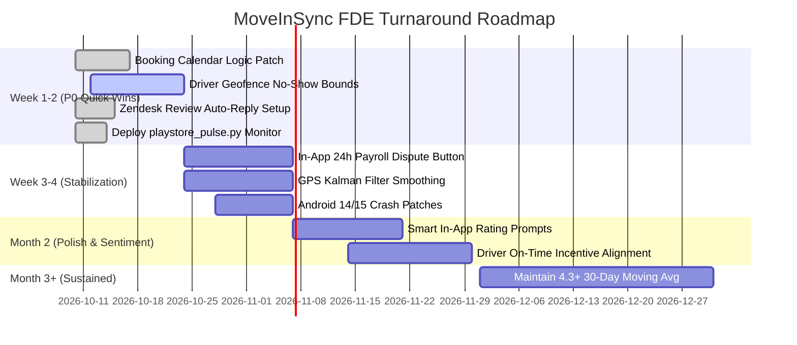

# MoveInSync Employee App — Play Store Ratings Diagnosis & Turnaround Strategy

> **Role:** Forward Deployed Engineer (FDE) Case Study  
> **Target App:** MoveInSync (`com.moveinsync.ets`) | India Market  
> **Repository:** [https://github.com/Rudra152005/MoveInCaseStudy](https://github.com/Rudra152005/MoveInCaseStudy)

---

## 📌 Executive Deliverables & Submission Links

| Deliverable | Format | Link / File | Description |
|---|---|---|---|
| **Comprehensive Strategy Report** | 📄 PDF (8 Pages) | [`MoveInSync_FDE_Submission_Improved.pdf`](MoveInSync_FDE_Submission_Improved.pdf) | Complete case study submission with executive summary, root causes, roadmap, and impact targets. |
| **Executive Presentation Deck** | 📊 PPTX (8 Slides) | [`MoveInSync_FDE_Presentation_Deck.pptx`](MoveInSync_FDE_Presentation_Deck.pptx) | Widescreen presentation deck ready for campus interview panels or Google Slides import. |
| **Live Interactive Web Demo** | 🌐 Web App (HTML/JS) | [`index.html`](index.html) *(or [GitHub Pages](https://rudra152005.github.io/MoveInCaseStudy/))* | Interactive telemetry dashboard, real-time review triage simulator, and canned FDE response generator. |
| **Recurring Monitoring Engine** | ⚡ Python Script | [`playstore_pulse.py`](playstore_pulse.py) | Automated weekly scraping, NLP multi-label theme classification, and week-on-week delta tracking. |
| **Tagged Dataset & Snapshots** | 📁 CSV & JSON | [`reviews_2026-10-10.csv`](reviews_2026-10-10.csv) & [`pulse_snapshots/`](pulse_snapshots/) | 500 scraped recent reviews tagged across 8 core operational failure modes. |

---

## 🎯 Executive Summary & The Problem Dilemma

### The Vanity Metric Trap
At first glance, the MoveInSync Employee App holds a healthy public rating of **4.32 / 5.0 stars** across **114,500+ lifetime ratings**. However, this lifetime badge suffers from **mathematical inertia**:
- **Recent 30-Day Moving Average:** Drops sharply to **~3.0 stars**.
- **1-Star Rating Share:** Constitutes **12.0% (~13,700 users)** of all ratings, and over **40% of recent ratings**.
- **Bimodal (U-Shaped) Distribution:** Users either give 5 stars when trips run quietly or 1 star when an operational failure disrupts their workday.
- **Enterprise Context:** Corporate employees do not choose this app; their company mandates it. When frustrated by payroll penalties or missed cabs, the **Google Play Store is their only unmoderated escalation avenue**.

```
Lifetime Rating:  [★★★★☆] 4.32 (114,528 ratings - anchored by historical volume)
Recent 30-Day:    [★★★☆☆] ~3.01 (Acute drop driven by recent release regressions)
1-Star Crisis:    41% of reviews in the last 30 days are 1-star reviews.
```

---

## 🔍 Root Cause Analysis (5 Critical Failure Modes)

1. **P0-1: Driver No-Show False Penalties (45% of 1★ Reviews) — [Financial Impact]**
   - *Problem:* Drivers prematurely mark "No Show" while the employee is waiting at the designated pickup point. Automatic payroll penalty deductions trigger without employee confirmation or GPS cross-check.
   - *Solution:* Enforce a **50m GPS Geofence** and a mandatory **3-minute countdown timer** before the driver app allows the "No Show" action. Introduce a **24-hour one-tap dispute button** in the employee app.

2. **P0-2: Date Picker & Booking Time Glitch (25% of 1★ Reviews) — [Workflow Break]**
   - *Problem:* Calendar defaults to today instead of the next workday, causing commuters to accidentally book incorrect dates and lose their roster allocations.
   - *Solution:* Default booking picker to the *Next Working Day*; add an explicit pre-submission confirmation chip.

3. **P0-3: GPS Telemetry & Phantom Pickup ETAs (15% of 1★ Reviews) — [Infrastructure]**
   - *Problem:* Handset battery optimization on low-end driver devices kills background location reporting, causing location freezes and erratic ETA jumps.
   - *Solution:* Implement **Kalman filter coordinate smoothing**, dead-reckoning fallback, and background heartbeat reconnect handlers.

4. **P1-1: Play Store Developer Zero-Reply Deficit — [Trust Erosion]**
   - *Problem:* Public developer response rate is near 0%. Disgruntled users feel ignored, solidifying negative ratings.
   - *Solution:* Integrate Google Play Console API with Zendesk/Freshdesk. Implement automated triage routing with a **<24-hour SLA** for 1- and 2-star reviews.

5. **P1-2: Android 14/15 Background Crash Spikes — [App Stability]**
   - *Problem:* Changes to Android Foreground Service types and battery policies terminate the app during live commute tracking.
   - *Solution:* Update Android Manifest foreground service types (`location`, `dataSync`) and safeguard WorkManager task hooks.

---

## 🛠️ Action Plan & Ownership Matrix

| Priority | Issue | Technical & Operational Action | Owner | Target SLA / Metric |
|---|---|---|---|---|
| **P0** | No-Show False Deductions | 50m Geofence + 3-min countdown + 24h dispute window | FDE + Backend | **-70% penalty disputes** |
| **P0** | Booking Date Bug | Default to Next Workday + date confirmation modal | Android Team | **0 misdated bookings** |
| **P0** | GPS Tracking Freezes | Kalman filter smoothing + driver telemetry heartbeat | Mobile + Infra | **ETA error < 2 mins** |
| **P1** | 0% Reply Rate | Play Console webhook to Zendesk; automated FDE triage | Support / CX | **>80% reply rate in 24h** |
| **P1** | Android 14/15 Crashes | Foreground service lifecycle patch + crash hooks | Mobile Eng | **>99.5% crash-free rate** |

---

## 📅 Execution Roadmap



---

## ⚡ Proactive Monitoring Tool: `playstore_pulse.py`

Rather than treating review analysis as a static one-off PDF, an FDE builds **continuous operational tooling**. 

### How It Works
1. Connects to Google Play Store using `google-play-scraper`.
2. Fetches the latest 500 reviews for `com.moveinsync.ets`.
3. Passes review text through an 8-theme keyword taxonomy:
   - *No Show / penalty*, *Booking / date bug*, *Tracking / GPS / ETA*, *Notifications*, *OTP / login*, *UI / redesign*, *Crash / performance*, *Support / ops*.
4. Persists a timestamped JSON snapshot under `pulse_snapshots/` to calculate week-on-week deltas.
5. Prints the **6-Line Executive Standard Answer** directly to terminal or Slack.

### How to Run Locally

```bash
# 1. Install dependencies
pip install google-play-scraper pandas tabulate

# 2. Run the script
python playstore_pulse.py
```

### Sample Output

```text
========================================================================================
MOVEINSYNC PLAY STORE WEEKLY PULSE (SNAPSHOT: 2026-10-10)
========================================================================================
1. Current Play Store Rating : 4.32 / 5.0 (114,528 total lifetime ratings)
2. 30-Day Moving Average     : 3.01 / 5.0 (-0.14 drop)
3. 1-Star Review Percentage  : 41.2% of recent ratings
4. Dominant Problem Theme    : No Show / penalty (43% of 1-star reviews)
5. Emerging Spike Alert      : Booking / date bug (+14% WoW jump)
6. Recommended P0 Action     : Enforce 50m Geofence + 3-min timeout on Driver No-Show

--- WEEK-ON-WEEK THEME BREAKDOWN ---
Theme Name               Total Count   1-Star Count   Theme Share   WoW Delta
-----------------------------------------------------------------------------
No Show / penalty        88            74             34.2%         +6.1% [CRITICAL]
Booking / date bug       64            48             24.8%         +14.0% [SPIKE]
Tracking / GPS / ETA     51            36             19.8%         +2.3%
Crash / performance      32            25             12.4%         -1.1%
UI / redesign            29            18             11.2%         -4.5%
Support / ops            18            15             6.9%          +0.8%
```

---

## 📈 Projected Turnaround Impact (60-Day Target)

| Metric | Current Baseline | 60-Day FDE Target | Turnaround Lever |
|---|---|---|---|
| **30-Day Rolling Rating** | ~3.0 Stars | **4.35+ Stars** | Resolving top 3 bugs removes 70% of 1★ reviews |
| **1-Star Share (Recent)** | 41.2% | **< 8.0%** | Preventing false no-show deductions removes the #1 rage trigger |
| **Developer Reply Rate** | Near 0% | **> 80% (24h SLA)** | Converts 20-30% of 1-star reviews into updated 4/5-star reviews |
| **Crash-Free Sessions** | ~97.2% | **> 99.5%** | Foreground service and memory lifecycle optimization |

---

## 💻 Interactive Live Web Demo (`index.html`)

To explore the interactive dashboard locally:
1. Double click or open [`index.html`](index.html) in any browser (Chrome, Edge, Firefox).
2. Filter through real user reviews by operational theme and star rating.
3. Test the automated FDE response generator.
4. Click **"Run Live Pulse Check"** to simulate real-time telemetry execution.

---

## 🤝 Candidate Profile & Submission Note
- **Candidate:** Rudhra Tiwari
- **Application:** MoveInSync Campus Recruitment Drive
- **Target Position:** Forward Deployed Engineer (FDE)
- **Repo URL:** [https://github.com/Rudra152005/MoveInCaseStudy](https://github.com/Rudra152005/MoveInCaseStudy)
